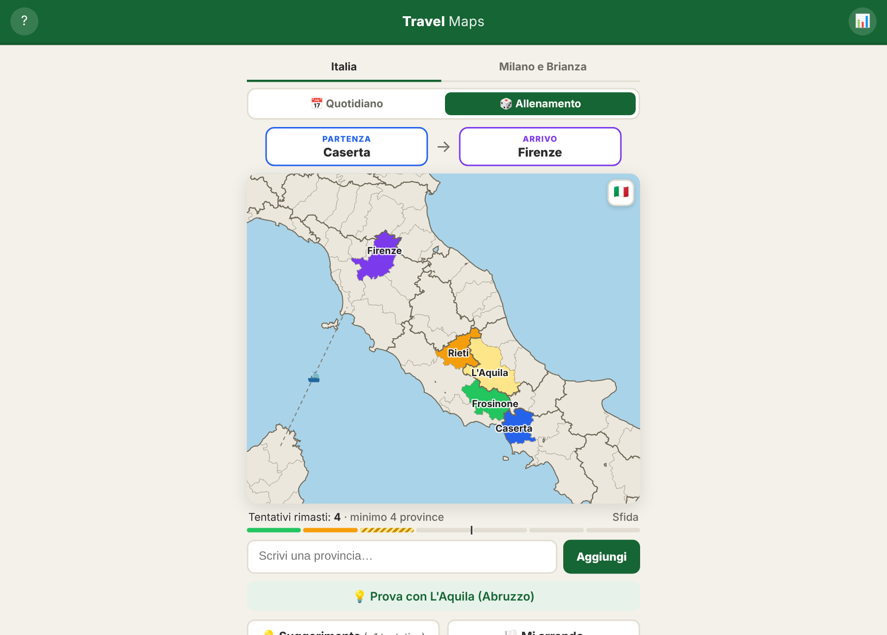
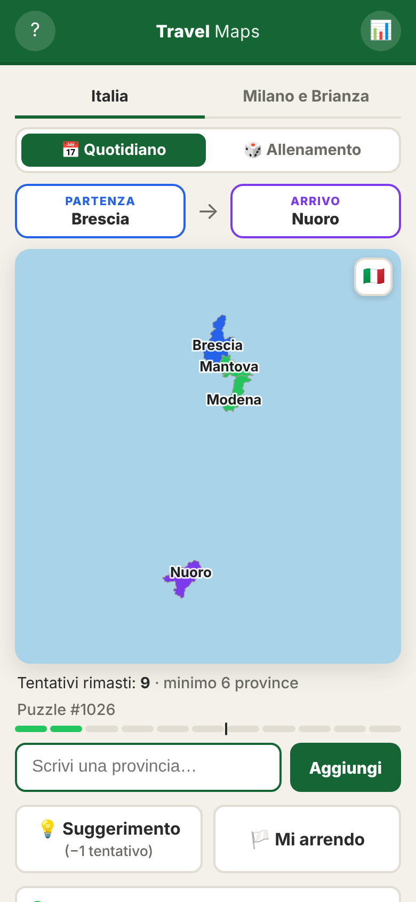
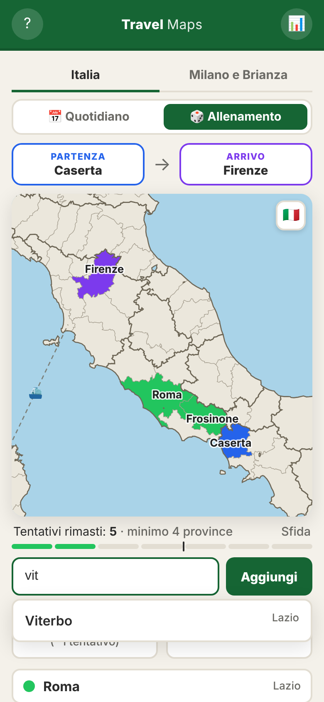
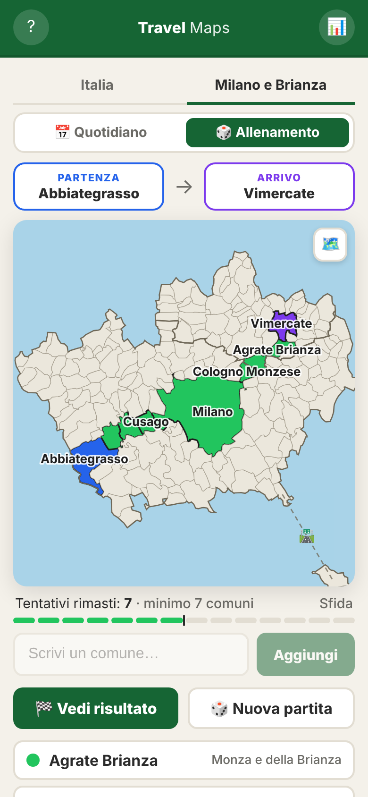
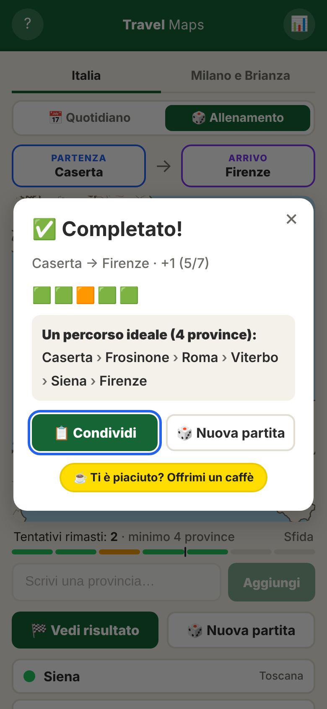
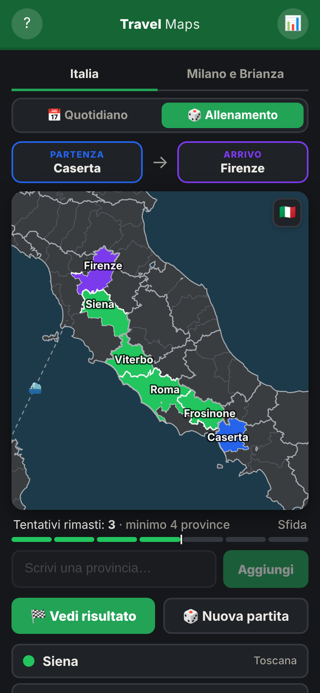
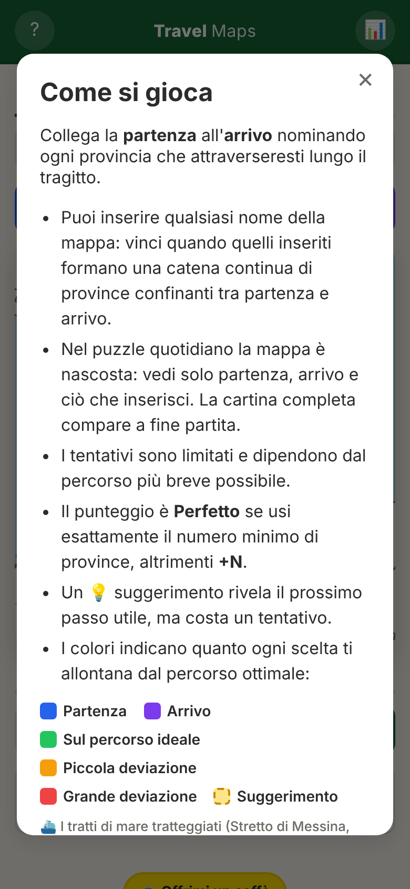

# Travel Maps

Un puzzle geografico quotidiano su più mappe: collega due **province italiane**, o due **comuni di Milano e Brianza**, nominando quelli che attraverseresti lungo il tragitto, nel minor numero di mosse possibile.

**Gioca online: <https://mastercruelty.github.io/travel-maps/>**

Ispirato a [travle](https://travle.earth/ita), riscritto da zero in HTML, CSS e JavaScript, senza framework né build. Ogni mappa ha il suo puzzle quotidiano, e il progetto è pensato per aggiungerne altre (vedi [Aggiungere una mappa](#aggiungere-una-mappa)).



## Mappe

Si sceglie la mappa dalle linguette in alto. Ognuna ha il suo puzzle quotidiano, i suoi salvataggi e le sue statistiche.

| Mappa | Aree | Collegamenti tratteggiati | Indirizzo |
| --- | --- | --- | --- |
| **Italia** | 110 province | ⛴️ Stretto di Messina e traghetto Livorno–Olbia, per raggiungere Sicilia e Sardegna | `/` |
| **Milano e Brianza** | 188 comuni della Città metropolitana di Milano e della provincia di Monza e della Brianza | 🛣️ San Colombano al Lambro, staccato dal resto della città metropolitana, collegato a San Zenone al Lambro | `/?mappa=milano` |

Nella mappa di Milano il capoluogo confina con 23 comuni ed è un passaggio naturale per molti percorsi: è una caratteristica della mappa.

## Come si gioca

- Ogni partita ha un'area di **partenza** e una di **arrivo**, distanti tra 4 e 8 confini.
- Scrivi il nome di una provincia (o di un comune) qualsiasi: vinci quando quelli inseriti formano una **catena continua di aree confinanti** tra partenza e arrivo.
- I tentativi sono il numero minimo di aree necessarie più un margine. Italia: almeno 3 in più, circa l'80% del minimo per i percorsi lunghi. Milano e Brianza, dove i nomi sono meno noti: almeno 4 in più, pari al minimo per i percorsi lunghi.
- Ogni area si colora in base a quanto allunga il percorso ideale:
  🟩 nessuna deviazione · 🟧 fino a 2 aree in più · 🟥 oltre.
- Il punteggio è **Perfetto** se usi esattamente il numero minimo di aree, altrimenti **+N**.
- Un 💡 **suggerimento** indica il prossimo passo utile a partire da ciò che hai già inserito e costa un tentativo. Finché non lo usi, chiederlo di nuovo ti mostra lo stesso senza costi.
- Per arrenderti premi 🏳️ due volte: la prima chiede conferma.
- I collegamenti tratteggiati della tabella sopra contano come confini.

### Quotidiano e allenamento

- **Quotidiano**: lo stesso puzzle per tutti, cambia a mezzanotte (ora locale). La **mappa è nascosta**: all'inizio vedi solo partenza e arrivo, e ogni area che inserisci compare sulla cartina. La mappa intera, con i confini di regioni o province e i collegamenti tratteggiati, si svela a fine partita, che tu vinca, perda o ti arrenda. Le statistiche contano solo le partite quotidiane.
- **Allenamento**: partite casuali illimitate con la mappa sempre completa. Il risultato include un **link sfida** per far giocare a un amico lo stesso percorso, ad esempio `?da=CE&a=FI` (Caserta → Firenze) o `?mappa=milano&da=015002&a=108050` (Abbiategrasso → Vimercate).

## Funzionalità

- **Mappa interattiva**: zoom automatico sulla zona della partita, nomi sulle aree scoperte (se due nomi si sovrappongono resta il più importante, l'altro si legge toccando l'area) e pulsante 🇮🇹 / 🗺️ per vedere la mappa intera.
- **Autocompletamento** tollerante: accenti, apostrofi, sigle (`RM`) e nomi alternativi (`Reggio Emilia`, `Olbia`, `Bozen`…). Con Invio la provincia viene scelta solo se il testo non è ambiguo: `reggio` chiede quale delle due.
- **Risultato condivisibile** con griglia di emoji, conto alla rovescia al prossimo quotidiano e percorso ideale.
- **Statistiche** salvate nel browser: partite, percentuale di vittorie, serie di giorni consecutivi e distribuzione dei punteggi.
- Partita quotidiana **salvata** automaticamente: puoi chiudere la pagina e riprendere.
- **Tema scuro** automatico, layout per mobile, navigazione da tastiera.

| Quotidiano | Allenamento | Milano e Brianza | Risultato | Tema scuro | Regole |
| :---: | :---: | :---: | :---: | :---: | :---: |
|  |  |  |  |  |  |

## Avvio in locale

### Con Docker

```bash
docker compose up --build
```

Poi apri <http://localhost:8000>. Per fermarlo: `docker compose down`.

L'immagine usa nginx con compressione gzip e un controllo di salute del container.

### Con Node.js

```bash
npm start
```

Avvia un piccolo server statico, senza dipendenze, su <http://localhost:8000>.

## Pubblicazione

Il workflow `.github/workflows/pages.yml` pubblica il gioco su GitHub Pages a ogni push su `main`, copiando solo i file del gioco (`index.html`, `style.css`, `game.js`, `data/`).

## Sviluppo

### Test

I test end-to-end usano [Playwright](https://playwright.dev) e girano su un browser desktop e su uno mobile emulato:

```bash
npm ci
npx playwright install chromium
npm test
```

Coprono entrambe le mappe e il passaggio tra le linguette, il puzzle quotidiano con la mappa nascosta, l'allenamento, i salvataggi, l'autocompletamento, il tocco sui suggerimenti, i colori, i suggerimenti, la sconfitta, la resa, le statistiche, i link sfida e lo zoom. La CI (`.github/workflows/ci.yml`) li esegue con Node.js 22 a ogni pull request e a ogni push su `main`.

### Screenshot

```bash
npm run screenshots
```

Rigenera le immagini di questo README in `docs/screenshots/`. Usa sempre le stesse partite di allenamento (Caserta → Firenze, Abbiategrasso → Vimercate) e, per il quotidiano, una data fissa, così le immagini non cambiano da un giorno all'altro. Con `CHROMIUM_PATH` si può indicare un Chromium già installato.

### Dati delle mappe

`data/italia.json` e `data/milano.json` sono generati da `tools/build_data.py` a partire dai confini ufficiali ISTAT:

```bash
pip install shapely
python3 tools/build_data.py            # tutte le mappe
python3 tools/build_data.py milano     # solo una
```

Per ogni mappa lo script:

1. scarica i confini da [openpolis/geojson-italy](https://github.com/openpolis/geojson-italy), fissato a un commit preciso;
2. calcola quali aree confinano tra loro;
3. collega le parti staccate (isole, exclavi) all'area più vicina, come un traghetto;
4. semplifica i confini mantenendo identici i tratti condivisi tra aree vicine;
5. calcola per ogni area il punto in cui scrivere il nome, il riquadro per lo zoom e il contorno dei gruppi (regioni o province).

### Aggiungere una mappa

1. In `tools/build_data.py` aggiungi una voce a `MAPS` con i file sorgente di openpolis, i campi da usare e le tolleranze, poi rigenera i dati.
2. In `game.js` aggiungi la stessa chiave a `MAPS`, con i testi (singolare e plurale, messaggi), il prefisso dei salvataggi e la distanza dei puzzle.
3. In `index.html` aggiungi la linguetta con `data-map="<chiave>"`.

## Struttura

```
├── index.html, style.css, game.js   il gioco
├── data/italia.json, milano.json    aree, confini e mappa di ogni mappa (generati)
├── tools/
│   ├── build_data.py                genera i dati dai confini ISTAT
│   ├── serve.mjs                    server statico per `npm start` e per i test
│   └── screenshots.mjs              genera gli screenshot del README
├── tests/game.spec.js               test end-to-end
├── playwright.config.js             configurazione dei test (desktop e mobile)
├── Dockerfile, docker-compose.yml, nginx.conf
└── .github/workflows/               CI e pubblicazione su GitHub Pages
```

## Supporta il progetto

Il gioco è gratuito e senza pubblicità. Se ti piace puoi [offrirmi un caffè su PayPal](https://paypal.me/mastercruelty).

## Crediti

- Idea e meccanica di gioco: [travle](https://travle.earth) di Oisín Carroll (Teuteuf Games).
- Confini di province e comuni: dati ISTAT distribuiti da [openpolis/geojson-italy](https://github.com/openpolis/geojson-italy) con licenza CC BY 4.0.

Codice rilasciato con licenza [MIT](LICENSE).
